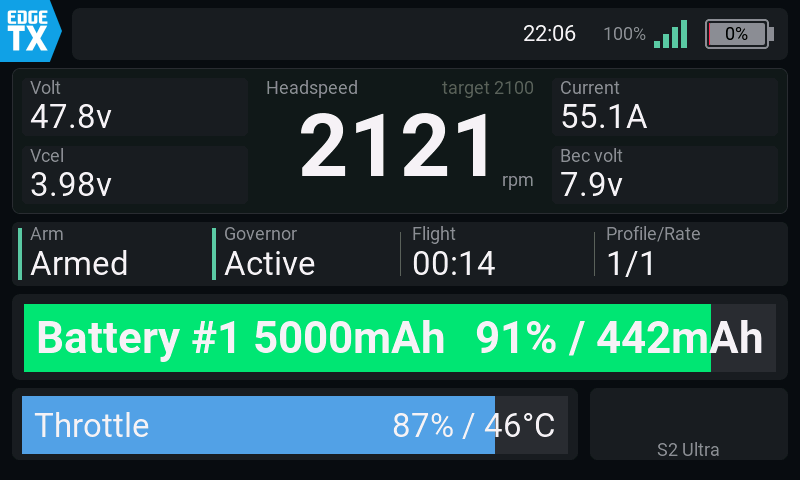
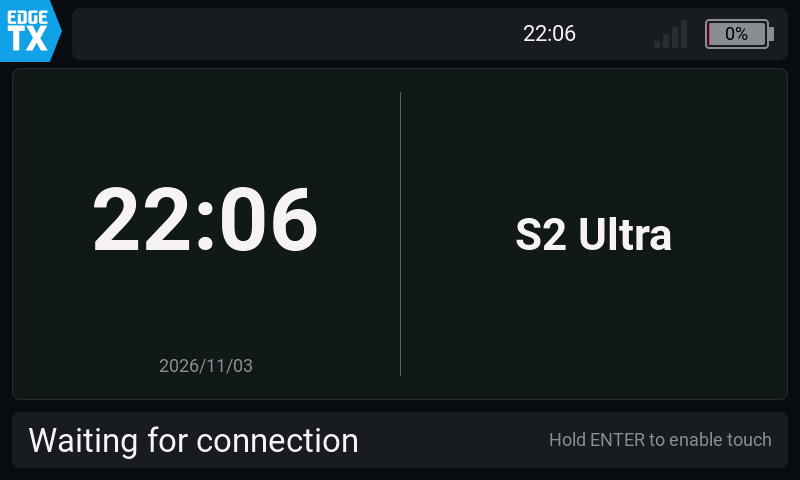
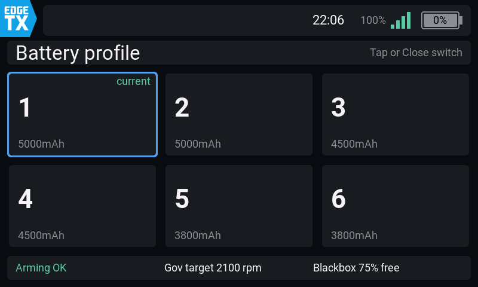
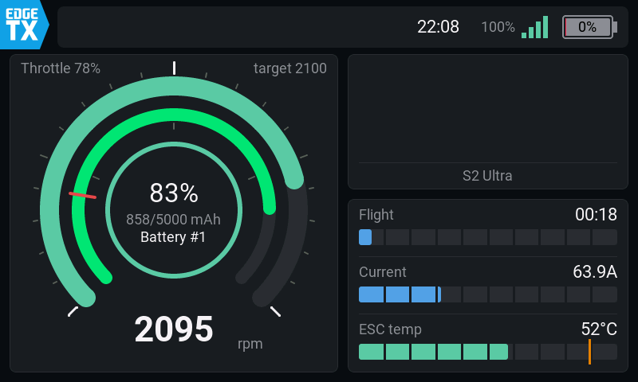
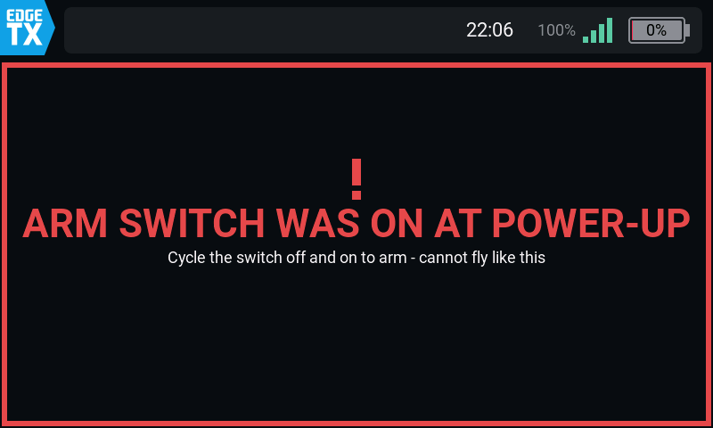
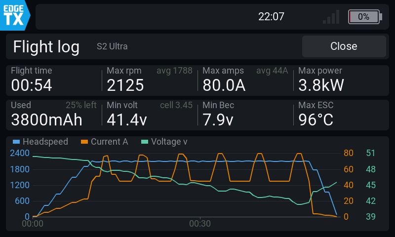

# RotorHUD — Rotorflight テレメトリウィジェット (EdgeTX / TX16S MK3)

Rotorflight を積んだヘリのテレメトリを、EdgeTX のカラー液晶にウィジェットとして表示する Lua ウィジェットです。
ヘッドスピードを中心に、電圧・電流・バッテリー残量・ガバナー状態などを 1 画面にまとめ、
ARM 警告、フライトログ、バッテリープロファイルの選択、音声と振動によるアラームなどを備えています。

**[English version below](#english)**

> **開発中です**: RotorHUD は現在も開発を続けています。実機 (TX16S MK3) で確認しながら進めていますが、
> 画面や設定、ファイルの配置は今後変わることがあります。



> **免責事項**: 本ウィジェットは**ご自身の責任**でお使いください。使用したこと、または使用できなかったことによって生じた損害 (機体・送信機・SD カードの損傷、墜落、人身・物損事故など) について、作者は責任を負いかねます。表示やアラーム (音声・振動) の正確さは保証できません。飛行前の点検と機体の状態確認は、操縦者ご自身でお願いします。

## 特長

- **ヘッドスピード中心のダッシュボード**: Volt・Vcel・Current・Bec volt、Governor、Flight (MM:SS)、Profile/Rate、
  Battery バー (% / mAh)、Throttle バー (% / ℃)
- **シンプル表示**: スロットルとバッテリー残量の円弧、大きな機体画像、飛行時間・電流・ESC 温度のバーで構成した、ひと目で読める画面
- **接続状態に合わせた画面切替**: 待機 ("Waiting for connection") → ダッシュボード。
  DISARM 中に `ARMD` ≠ 0 のときは全画面の ARM 警告 (原因と対処も表示)、切断後はフライトログを表示します。
  ARM 中に FC がアーム不可のフラグを立てた場合 (フェイルセーフなど) は、画面を切り替えずトップバーに赤く `FC: …` と表示します。
  電源投入直後の FC の起動待ち (BOOT GRACE / CALIBRATING だけのとき) は、赤い警告ではなく青い「FC STARTING UP」の画面にし、
  注意音・振動は鳴らしません (理由を 1 回読み上げるだけ)。満充電チェックもその後に行います
- **再接続で全リセット**: 最大・最小値とフライトタイマーを初期化してから表示します
- **接続直後のバッテリープロファイル選択**と、**満充電チェック** (満充電でなければお知らせ)
- **メニュー** (全画面時、DISARM 中): Rotorflight 設定 (タッチ対応の画面)、バッテリープロファイル、
  FC 設定の閲覧、ブラックボックス消去、飛行履歴、Settings
- **アラーム (音声 + 振動)**: 危険 / 注意 / 情報の 3 段階。声は日本語 6 種 (VOICEVOX) と英語 2 種 (Piper) から選べます
- **3 テーマ** (color / mono / cyan) と、機体名と同じ名前の PNG による機体画像の表示
- **検証環境**: EdgeTX Companion シミュレータ用のスクリプトと、画面なしのテスト (`tools/luatest`) を同梱しています

## 画面

| 待機 | バッテリープロファイル選択 |
|---|---|
|  |  |
| **ダッシュボード** | **シンプル表示** |
|  |  |
| **ARM 警告** | **フライトログ** |
|  |  |

画像は EdgeTX Companion のシミュレータで撮ったものです (機体画像は表示していません)。

## 動作環境

| 項目 | 内容 |
|---|---|
| 対象送信機 | RadioMaster TX16S MK3 (800×480) |
| 対象ファームウェア | EdgeTX v2.12.0 "Queen Anne's Revenge" (edgetx-tx16smk3) |
| 通信 | CRSF / ExpressLRS |
| FC | Rotorflight 4.6 (センサー名は後述) |
| ウィジェット名 | `RotorHUD` (`/WIDGETS/RotorHUD/`: main.lua・core.lua・view.lua・rf2ui.lua) |

## インストール

1. `sdcard/` の中身を、送信機の SD カードのルートへコピーしてください
   (`WIDGETS/RotorHUD/` の 4 ファイル、`IMAGES/`、`SOUNDS/` がそれぞれ対応します)。
   Windows では、手作業のかわりに `scripts/deploy.ps1` も使えます:
   `powershell -NoProfile -ExecutionPolicy Bypass -File scripts\deploy.ps1 -Target E:\`
   - `-Target` は SD のルートです。`auto` にすると、EdgeTX の SD カードらしいリムーバブルドライブを自動で探します
   - `-Tools` で診断ウィジェットも一緒にコピーし、`-DryRun` ではコピー対象の一覧だけを表示します
   - 追加と上書きだけを行い、SD 上のファイルは削除しません
   - 送信機を USB ストレージモードにするか、カードリーダーで SD を挿してから実行してください
2. 送信機側: ウィジェット画面 → 空きゾーンを長押し → Add Widget → `RotorHUD`。
   1 ゾーンの全画面レイアウトをおすすめします (小さいゾーンでは簡易表示になります)。
3. **Rotorflight のカスタムテレメトリは RotorHUD が自分で読み取ります** (下記)。Rotorflight 公式 Lua の
   **rf2bg (スペシャルファンクション) と RfTool ウィジェットは外してください**。
4. FC 側でカスタムテレメトリを設定してください (下の「Rotorflight 側の設定」)。
5. 機体を接続すると、センサー (Gov / Hspd / Vbat / BAT# など) が自動で作られます。

## Rotorflight 側の設定 (テレメトリ)

RotorHUD は Rotorflight の **CRSF カスタムテレメトリ**を使います。FC 側でカスタムテレメトリを有効にし、
次のセンサーを送るように設定してください (Rotorflight Configurator の受信機のテレメトリ設定、または CLI)。

| RotorHUD での名前 | Rotorflight のセンサー | 番号 | 使う場所 |
|---|---|---|---|
| `Vbat` | Battery voltage | 3 | 電圧 |
| `Curr` | Battery current | 4 | 電流、最大電流・電力 |
| `Capa` | Battery consumption | 5 | 消費容量 (mAh) |
| `Bat%` | Battery charge level | 6 | 残量 %、残量のアラーム |
| `Cel#` | Battery cell count | 7 | セル数 |
| `Vcel` | Battery cell voltage | 8 | セル電圧、セル電圧のアラーム、満充電チェック |
| `Thr` | Throttle control | 15 | スロットル |
| `Vbec` | BEC voltage | 43 | BEC 電圧とアラーム |
| `Tesc` | ESC temperature | 50 | ESC 温度とアラーム |
| `Hspd` | Headspeed | 60 | ヘッドスピード |
| `ARM` | Arming flags | 90 | ARM / DISARM |
| `ARMD` | Arming disable flags | 91 | ARM 警告 |
| `Gov` | Governor state | 93 | ガバナー状態 |
| `PID#` | PID profile | 95 | PID プロファイル |
| `RTE#` | Rates profile | 96 | レートプロファイル |
| `BAT#` | Battery profile | 97 | バッテリープロファイル |

CLI では次のとおりです (Rotorflight 4.6。`telemetry_sensors` は 40 枠あり、書かなかった枠は前の値のまま残るので、0 で埋めています)。

```
set crsf_telemetry_mode = CUSTOM
set telemetry_sensors = 3,4,5,6,7,8,15,43,50,60,90,91,93,95,96,97,0,0,0,0,0,0,0,0,0,0,0,0,0,0,0,0,0,0,0,0,0,0,0,0
save
```

- 接続して 6 秒たっても届いていないセンサーがあると、画面下の帯にオレンジで `Not in the FC telemetry: BAT#` のように 12 秒間表示します。
  バッテリープロファイルの選択画面は、`BAT#` が実際に届いているときだけ出ます (送信機に古い値が残っていても出しません)
- 消費容量は ESC が測った値 (`EscC`、ESC1 capacity = 19) でも表示できます。両方あるときは `EscC` を使います
- リンク品質 (`RQly` など) は ExpressLRS 側のセンサーをそのまま使います
- センサーの番号は Rotorflight 4.6.0 のソース (`src/main/telemetry/sensors.h`、CLI は `src/main/cli/settings.c`) で確認しています。
  ほかのバージョンでは異なる場合があります

## Rotorflight テレメトリの内蔵デコーダー

RotorHUD は Rotorflight の CRSF カスタムテレメトリ (0x88) を自分で読み取り、公式と同じ ID・名前でセンサーを作ります。
rotorflight-lua-scripts の `rf2tlm.lua` / `rf2tlm_sensors.lua` / `MSP/crsf.lua`・`common.lua` を移植したものです (GPL-3.0)。
- **rf2bg のスペシャルファンクションは不要で、外しておく必要があります**: Lua の受信キューはすべてのスクリプトで 1 本しかないため、
  2 つのスクリプトが読むとフレームを取り合い、両方の値が欠けてしまいます。
  外し方: Model → Special Functions → `Lua Script` で `rf2bg` を選んでいる行を削除 (または OFF) します。
  RfTool ウィジェットを画面に置いている場合は、そちらも削除してください
- 受信を自分で受け持つので、**MSP の応答も受け取れます**: 接続後に各バッテリープロファイルの容量 (mAh)、ガバナー目標、
  ブラックボックスの空き容量などを FC から読み、画面に表示します
- 公式の初期化処理 (rf2bg) のうち、**機体名の自動設定も移植しています**: FC の「Set model name」(RF2 の Model ページ) が ON なら、
  接続中は機体名を FC の名前に変え、切断すると元に戻します (元の名前は settings.txt の `prevName` に保存)。
  RTC 設定とタイマー/GV のパラメータ設定は移植していません
- rf2bg を使い続けたい場合は `CONFIG.telemetry.decode = false` にしてください (このとき容量などの自動取得は使えません)
- テスト: `tools/luatest/decoder_test.lua` (手組みのフレームでセンサー・容量・機体名・ブラックボックス消去を照合)

## ライセンス

GNU General Public License v3.0 ([LICENSE](LICENSE))。テレメトリデコーダーと MSP 処理は
[rotorflight-lua-scripts](https://github.com/rotorflight/rotorflight-lua-scripts) (GPL-3.0) から移植しています。
音声のクレジットと利用規約は [sdcard/SOUNDS/rf/CREDITS.txt](sdcard/SOUNDS/rf/CREDITS.txt) をご覧ください
(日本語は VOICEVOX の各キャラクターの利用規約に、英語は Piper の音声モデルのライセンスに従います)。

## タッチを使う場合 (App mode レイアウト)

EdgeTX では、タッチとキーがウィジェットに届くのは**全画面表示のときだけ**で、Lua から全画面にすることはできません。
EdgeTX 2.12 の **App mode** レイアウトを使うと、ENTER の長押しだけで RotorHUD を全画面にできます。
1. 画面設定 (Screens) → レイアウトを **App mode** にして RotorHUD を置きます
2. 電源を入れたら **ENTER を長押し** → 全画面になり、タッチ・ダイヤル・ENTER が RotorHUD に届きます。
   全画面でないときは、待機画面などに「Hold ENTER to enable touch」と表示されます
3. EdgeTX のメニューに戻るときは **RTN の長押し**で全画面を抜けます (App mode では左上の EdgeTX ボタンからも戻れます)
- タッチを使わなくても、フライトログを閉じる・プロファイルを選ぶといった操作は `Close` に割り当てたスイッチでできます
- 左上の EdgeTX アイコンは、App mode で**全画面でないとき**に EdgeTX 本体が表示するもので、設定では消せません。
  全画面にすると消えます

## 描画方式とファイル構成

EdgeTX の lvgl ウィジェット (EdgeTX 2.11 以降) です。各画面を 1 回組み立て、変わった値だけを描き直します。
実機の計測 (tools/diagtest の DrawBench / LvglBench) では、旧来の lcd 描画の 4〜6fps に対し、12〜20fps で動作します。

| ファイル | 中身 | 読み込み |
|---|---|---|
| `main.lua` | 名前・オプションだけの入口 | EdgeTX の起動時 (全ウィジェット分が読まれるので小さくしています) |
| `core.lua` | 設定・テレメトリ (内蔵デコーダー、MSP)・アラーム・バッテリー選択・履歴・メニュー | ウィジェットの作成時 |
| `view.lua` | 画面 | ウィジェットの作成時 |
| `rf2ui.lua` | Rotorflight settings の画面 | 初めて開いたとき |

- ボタン (メニュー、Settings、バッテリー選択のタイル、フライトログの Close、RF2 設定) は**全画面のときだけ**表示されます
  (EdgeTX の仕様)。全画面のときは左上に Touch バッジが出ます

## メニュー (全画面時、DISARM のみ)

待機画面かダッシュボードのトップバーにある **Menu** (または ENTER) で開きます。ARM すると、メニューと開いている画面は閉じます。

| 項目 | 中身 |
|---|---|
| Rotorflight settings | 公式 RF2 の設定ツールをウィジェット内で動かし、タッチで操作しやすい画面にしたもの (下記)。接続中のみ |
| Battery profile | 接続直後と同じプロファイル選択画面。接続中で `BAT#` があるとき |
| View FC settings | PID ゲイン / レート / ガバナープロファイルの閲覧 (下記)。接続中のみ |
| Erase blackbox | FC のブラックボックス (dataflash) を消去します。1 回目のタップで「Tap again: erase (NN% used)」(オレンジ、3 秒) と表示され、もう一度タップすると消去します。進み具合と結果は画面下の帯に出ます (Erasing… → 緑の Blackbox erased + 確認音・振動)。接続中で、ブラックボックスの情報が読めたときのみ |
| Flight history | この機体の飛行履歴 (下記) |
| Settings | 音声・アラーム・飛行・パック名・表示の設定 (下記) |

### Rotorflight settings
- SD に rotorflight-lua-scripts の**一式** (`SCRIPTS/RF2`・`SCRIPTS/TOOLS/rf2.lua`・`SCRIPTS/FUNCTIONS/rf2bg.lua`・
  `WIDGETS/RfStats`・`WIDGETS/RfTool`) を置いておいてください (置くだけで、rf2bg のスペシャルファンクションと RfTool ウィジェットは使いません)。
  初回は RF2 のコンパイルが走り、終わると自動で開き直します
- 公式 RF2 (lvgl 版) の画面部品だけを差し替えています (`rf2ui.lua`)。値の読み書き・保存・再起動は RF2 の処理そのままです
- メインメニューはタイル、各ページはカードや表で表示します (指で縦にスクロール)。値をタップすると下から編集パネルが出ます
  (スライダー、-10 -1 +1 +10、OK / Cancel。選択肢はボタンを並べて 1 タップで選べます)。上部に Back / Save / Menu (Reload・Reboot FC)
- Save 後、FC への書き込みが終わると緑の「Saved to the FC」を 2.5 秒表示し、確認音と振動 2 回でお知らせします。
  ARM 中などで保存できないときは RF2 の警告が出て、Saved は表示されません
- `CONFIG.tools.rf2Skin = false` にすると RF2 公式の画面になります。RTN でも戻れます
- ExpressLRS の Lua ツールは描画方式の違いでウィジェット内では開けないため、SYS > Tools からお使いください

### FC 設定の閲覧 (全画面不要)
- オプション `Page` に割り当てたスイッチを押すたびに、PID ゲイン → レート → ガバナープロファイル → 通常画面 と切り替わります
  (メニューの View FC settings からも開けます)。閲覧のみで、変更は Rotorflight settings から行います
- 閲覧中にスイッチで PID / レートのプロファイルを切り替えると、そのプロファイルの値を読み直します。ARM・切断で閉じます

### Flight history
- 飛行ごと (ローター回転 10 秒以上、`CONFIG.history.minSec`) に、切断の時点で記録します
  - `/LOGS/RotorHUD-<機体名>.csv`: 1 飛行 1 行 (日時、パック、ローター時間、消費 mAh、残量、最大 rpm・A・W、最低電圧・セル・BEC、最高 ESC 温度)
  - `/WIDGETS/RotorHUD/stats-<機体名>.txt`: 合計 (回数・ローター時間・mAh・最終日時)、パック (バッテリープロファイル) ごとの回数・mAh・最終使用、直近 6 飛行
- 画面: 合計 4 項目、パックごとの表 (Settings > Packs で名前を付けていればその名前)、直近の飛行の表
- **Reset** (タイトルの右): 1 回目で「Sure?」(赤、3 秒)、もう一度で集計を 0 に戻します。`/LOGS` の CSV はそのまま残ります

### Settings
SD の `/WIDGETS/RotorHUD/settings.txt` に保存されます。ウィジェットオプションの同じ項目 (Theme / Voice / BattLand) より優先されます。

| タブ | 項目 |
|---|---|
| Voice | 声 (試聴付き)、アラーム On/Off、振動 On/Off、効果音 On/Off (試聴付き) |
| Alarms | 着陸指示の残量 %、セル電圧 注意/危険、ESC 温度 注意/危険、BEC |
| Flight | 飛行時間の読み上げ、フライトログを閉じるまでの秒数、満充電チェック On/Off と満充電とみなすセル電圧 (既定 4.10V)、バッテリー選択を現状のまま閉じるまでの秒数 (0 = 閉じない) |
| Packs | バッテリープロファイル 1〜6 の名前 (例 `6S 5000`、16 文字まで。タップで EdgeTX のキーボードが開きます)。右に FC の容量を表示。選択画面のタイルと履歴に使われます。空にすると `Profile N` |
| Display | テーマ、fps 表示、機体画像、シンプル表示 (下記) |

設定を追加するときは、`core.lua` の `SETTINGS` に 1 行足してください (必要なら `SET.groups` にタブも)。

### シンプル表示 (Settings > Display > Simple screen)
ダッシュボードの代わりに、図形を中心にした画面を表示します。
- 左のカード: スロットルの円弧 (0〜100%、270°、下が開いた形) と、外周の目盛 (5% ごと、0 / 50 / 100% は白く長い目盛)。
  塗りの色はガバナーの状態を表します。左上に `Throttle NN%`、右上にガバナー目標を表示します。
  その内側にバッテリー残量の円弧があります (色は通常と同じく 50% / 20% で切り替わり、灰色の小さな目盛が 25 / 50 / 75%、赤い目盛が着陸指示の %)。
  中央のリングはアーム状態 (緑 = ARM、灰色 = DISARM) で、中に残量 %、`消費/容量 mAh` (容量は選択中のバッテリープロファイルのもの)、
  バッテリープロファイル (Settings > Packs の名前、無ければ `Battery #N`) を表示します。下の開いた部分にヘッドスピードを表示します
- 右上のカード: 機体画像を大きく表示します。`/IMAGES/<機体名>-L.png` (320×124、透過。`CONFIG.simple.imageW/H`)、無ければ通常の小さい画像
- 右下のカード: 飛行時間 (満量は Settings の飛行時間読み上げの秒数、Off なら `CONFIG.simple.flightSec`)、電流 (`CONFIG.simple.currentMax`)、
  ESC 温度 (満量は ESC 危険の温度、オレンジの目盛が注意の温度。注意でオレンジ、危険で赤) の 10 分割バー
- トップバー・Menu・警告はダッシュボードと同じです

### 満充電チェック
接続ごとに 1 回、値が落ち着いてから (接続の静音時間 + 1 秒後)、DISARM かつローター停止の状態で Vcel が Settings > Flight の
「Full at cell」より低ければ、画面の上に **BATTERY NOT FULL** のウィンドウを出します (オレンジの枠、注意音 + 振動)。
セル電圧と基準値、電池の形 (3.5V〜基準値に対する割合で塗り) を表示します。閉じ方: ウィンドウのどこかをタップ (全画面時) /
ENTER・RTN / Close スイッチ (バッテリー選択より先にこちらを閉じます) / ARM / 10 秒で自動 (下のバーが残り時間、`CONFIG.alarm.fullAlertSec`)

## 画面の補足
- トップバー: 警告、時刻、リンク品質 (RQly の %)、電波バー、TX 電池 (中に残量 %。Radio Setup のバッテリー範囲で換算)
- ダッシュボードの Headspeed の右上に、FC のガバナー目標ヘッドスピード (`target 2100`。PID プロファイルが変わると読み直し) を表示します
- バッテリー選択画面の下段は飛行前チェックです: ARM の可否、ガバナー目標、ブラックボックスの空き (10% 未満でオレンジ)
- ARM 警告画面では、原因に応じた対処も表示します (例: FC の CMS メニューが開いている、CLI 接続中、再起動が必要 など)

## バッテリープロファイル選択 (接続直後)

機体と接続し、DISARM で ARM 警告が無ければ、FC の 6 つのバッテリープロファイルから選ぶ画面を表示します。
- 全画面表示のとき: タイルをタップで即決定 / ダイヤルで移動して ENTER で決定 / RTN で閉じる
- 全画面でないとき: `Close` のスイッチを押すたびに次へ進み、3 秒押さなければ決定します
- **オプション `BattSW`** を ON にすると、MK3 の **SW1〜SW6 ボタン**で直接選べます (ON のボタン n = プロファイル n。
  複数が ON なら最後に ON にしたもの)。電源を入れる前にボタンを押しておけば、接続後に操作なしで自動送信されます
- **オプション `BattSel`** はダイヤル/スライダー用です (6 等分)。SW1〜SW6 はそれぞれ独立した 2 ポジションスイッチなので、
  `BattSel` に割り当てると 1 か 6 にしかなりません
- **トリムボタンで前後に送る** (全画面不要): 画面横のダイヤルと SYS/MDL/TELE/PAGE/RTN/ENTER はスイッチ・ソースとして読めませんが、
  トリムの上下はスイッチとして論理スイッチに使えます。
  例: L10 = AND, V1 = T5 下 → `BattPrev` に L10 / L11 = AND, V1 = T5 上 → `Close` に L11。
  T5 をミキサーで使っていないことが条件です (押すとトリム値自体は動きます)。実機での設定はまだ確認していません
- 選ぶまで (または ARM するまで) 表示したままにします。ARM したらすぐ閉じ、現在のプロファイルのままになります (ARM 中は送信しません)。
  Settings > Flight の「Picker keeps after」を 1 以上にすると、その秒数で現在のまま閉じます
- 決定すると `MSP_SET_BATTERY_PROFILE` (176) を CRSF で送り、`BAT#` センサーが変わったら成功です
  (「バッテリープロファイル、N」)。2 秒ごとに再送し、3 回で失敗とします (「変更できませんでした」)
- FC はこの設定を保存しない (RAM のみ) ため、電源を入れるたびに選ぶ前提です
- タイルの名前は Settings > Packs で付けられます (例 "6S 5000")。容量は接続時に FC から読みます。無効にするには `CONFIG.batteryProfile.enabled = false`
- 根拠 (ソース確認): [docs/rotorflight_notes.md](docs/rotorflight_notes.md)

## アラーム (音声 + 振動)

`core.lua` の ALARMS と `CONFIG.alarm` で判定しています。画面に出ていない間も `background()` から判定します。

| 段階 | 振動 | 音声 | 項目 |
|---|---|---|---|
| 危険 | パターン | 10 秒ごと (残量は 20 秒ごと) | 残量 ≤ `BattLand` (既定 20%) で「バッテリー、NNパーセント」「着陸してください」(以後 1% 下がるごとに残量を読み上げ)、セル電圧 < 3.50V (2 秒継続)、ESC ≥ 90℃、BEC < 6.0V、ヘッドスピードロスト (FALLBACK)、回転中の通信断 |
| 注意 | 短く 1 回 | 1 回 | 残量 ≤ `BattLand` + 10%、セル電圧 < 3.60V (2 秒継続)、ESC ≥ 80℃、飛行時間 (`flightTimeSec`、既定オフ)、ARM 不可 (ARMD ≠ 0)、満充電でない |
| 情報 | 下記 | 変化時 | ARM / DISARM・レート (RTE#)・プロファイル (PID#)・バッテリープロファイル (接続直後にも現在値)、ガバナー状態、残量 10% 刻み (着陸指示以下は 1% 刻み) |

- **振動**: ARM で 1 回、DISARM で 2 回、レート・PID プロファイルの切り替えで 1 回 (同じスイッチで一緒に変わるので 1 回にまとめます)
- **効果音** (playTone): 接続 (上がる 2 音) / 切断 (下がる 2 音) / 注意 (2 回) / 危険 (高い 3 連) を音声の前に鳴らします。
  Settings > Voice > Sound effects で On/Off と試聴 (Test) ができます。Mute スイッチで音声と一緒に止まります。音の高さ・長さは `CONFIG.alarm.toneEffects`
- 接続・切断は EdgeTX 本体が読み上げるので、ウィジェットからは言いません (`CONFIG.alarm.edgetxLinkVoice = true`)。
  接続直後のウィジェットの報告 (ARM・レート・プロファイル・バッテリープロファイル・選択の案内) は、
  本体の音声と重ならないよう 3 秒遅らせています (`connectQuietSec`)。回転中の切断は振動のみです。
  本体の接続音声を止める設定 (モデルの「テレメトリアラーム無効」) は RSSI/RQly 低下の警告も止めてしまうので、おすすめしません
- 音声ファイルは `sdcard/SOUNDS/rf/<声>/` にあります (日本語は VOICEVOX、英語は Piper で生成。[docs/voicevox_script.md](docs/voicevox_script.md))。
  音量は RMS -14 dBFS に揃えています
- EdgeTX 標準機能でのバックアップ案: [docs/alarms_native.md](docs/alarms_native.md)。設定したら `CONFIG.alarm.nativeBackup = true`

## 設定

**コード側** — `core.lua` 冒頭の `CONFIG`

| キー | 既定 | 内容 |
|---|---|---|
| `theme` | `"color"` | `"color"` / `"mono"` / `"cyan"` (送信機側の Theme オプションや Settings が優先) |
| `showModelImage` | `true` | 機体画像の表示 (`/IMAGES/<機体名>.png`) |
| `modelImageW` / `modelImageH` | 186 / 46 | 機体画像ファイルの寸法 (この枠ぴったりで作ってください) |
| `vCellGood` / `vCellWarn` | 3.8 / 3.6 | セル電圧の色分けの閾値 |
| `escTempWarn` | 90 | ESC 温度の警告の閾値 (℃) |
| `rpmRunningThreshold` | 50 | ローター回転中とみなす回転数 (最大値・最小値の記録条件に使用) |
| `flightLogTimeoutSec` | 0 | フライトログを自動で閉じるまでの秒数 (0 = 閉じない。Settings でも変更可) |
| `txBattery.minV` / `maxV` | 6.4 / 8.4 | TX 電池の % の換算範囲 (Radio Setup のバッテリー範囲が読めないときだけ使用) |
| `sensors.*` | — | センサー名の候補リスト (先頭が実機で確認した名前) |

**送信機側** — ウィジェットを長押し → Edit

| オプション | 内容 |
|---|---|
| `Theme` | `0`=color / `1`=mono / `2`=cyan (数値で指定します) |
| `Mute` | 消音に使うソース (スイッチ SA など、または論理スイッチ)。値が 0 より大きい間 (スイッチ下 / LS 真) は音声と注意の振動を止めます。危険の振動は止めません。空欄なら消音しません |
| `Close` | フライトログを閉じるソース (押しボタン SH など)。押した瞬間に待機画面へ戻ります。全画面でなくても使えます (全画面表示中はタップ・ENTER でも閉じられます)。バッテリープロファイル選択画面では「次のプロファイルへ」、満充電チェックのウィンドウが出ているときはそれを閉じます |
| `BattLand` | 着陸指示を出す残量 % (10〜50、既定 20) |
| `BattSW` | ON で SW1〜SW6 ボタンがバッテリープロファイル 1〜6 を選びます |
| `BattSel` | バッテリープロファイルを選ぶダイヤル/スライダー (6 等分。SW ボタンには使えません。空欄なら使いません) |
| `BattPrev` | 選択画面で 1 つ前のプロファイルへ (`Close` が次へ)。トリム → 論理スイッチ経由を想定しています |
| `Page` | FC 設定の閲覧ページを順に開くスイッチ |
| `Voice` | アラームの声。`0`=No.7 アナウンス / `1`=青山龍星 / `2`=玄野武宏 / `3`=冥鳴ひまり / `4`=Voidoll / `5`=ずんだもん / `6`=English 男性 / `7`=English 女性 |

**機体画像**: 機体名と同じ名前の PNG (例: `GOOSKY S2.png`) を `/IMAGES` に置いてください。表示は**等倍 1:1** なので、
**186×46 の透過キャンバスに、縮小した機体を中央に配置**したファイルを作ってください。シンプル表示用は
`<機体名>-L.png` (320×124) です。接続中に機体名が FC の名前に変わる場合は、その名前で探します。
メーカーの画像などから作ったものは著作権の都合でリポジトリに含めていないので、各自でご用意ください。

## 確認済みのセンサー名 (実機の Telemetry 一覧 42 項目から確定)

| 用途 | 名前 | 用途 | 名前 |
|---|---|---|---|
| ガバナー状態 | `Gov` | ヘッドスピード | `Hspd` |
| 電圧 / セル電圧 / セル数 | `Vbat` / `Vcel` / `Cel#` | 電流 | `Curr` |
| ESC 温度 | `Tesc` | 残量 % | `Bat%` |
| 消費容量 (mAh) | `EscC` | スロットル | `Thr` |
| BEC 電圧 | `Vbec` | レートプロファイル / PID プロファイル | `RTE#` / `PID#` |
| ARM フラグ | `ARM` | アーミング無効フラグ | `ARMD` |
| バッテリープロファイル | `BAT#` | 通信品質 | `RQly` (`1RSS`, `RSNR`, `RSSI`) |

- `ARM`: `0`/`2` = DISARM、`1`/`3` = ARM
- `ARMD`: 0 以外で全画面の警告を出します。`67108872` は「ARM スイッチが ON のまま機体の電源を入れた」状態です
- 消費容量・残量は DISARM で 0 に戻るため、ローター回転中だけ最大容量 / 最小残量を記録しています

## 開発

### VS Code

`sdcard/WIDGETS/RotorHUD/` の core.lua / view.lua / rf2ui.lua を編集します。拡張機能 `sumneko.lua` を入れると、
`.luarc.json` と `types/edgetx.lua` により EdgeTX API の補完・型チェックが効きます。
SD への反映は「インストール」の `deploy.ps1` コマンドでできます。

### シミュレータで確認する (EdgeTX Companion 2.12)

前提: Companion 2.12.0 (`C:\Program Files (x86)\EdgeTX\Companion 2.12`)。TX16S MK3 の 800×480 シミュレータを使います。

```powershell
# 起動 (Theme: 0=color / 1=mono / 2=cyan)。初回は SD イメージを sim\sdcard に自動作成
powershell -NoProfile -ExecutionPolicy Bypass -File scripts\sim.ps1 -Theme 0
# LCD を 800×480 等倍で保存 (sim\captures\)。シナリオ 1 周 = 140 秒
powershell -NoProfile -ExecutionPolicy Bypass -File scripts\sim-capture.ps1 -Count 25 -Interval 6
```

- `sim.ps1` は `sdcard\` を `sim\sdcard` にコピーし、**コピー側だけ** `CONFIG.simulate = true` にします
  (`sdcard\` の core.lua は false のまま)。Companion に「RotorHUD Sim (TX16S MK3)」プロファイルも作ります。
- `simulate = true` のとき、`readTelemetry` は `simulateTelemetry` のシナリオの値を返します
  (standby → armwarning → スプールアップ → 飛行 → 低電圧・ESC 高温 → THR-OFF → DISARM → flightlog)。
- `sim-capture.ps1` はシミュレータのカメラボタン (LCD をクリップボードへコピー) をクリックします。
  ボタンの位置は 2560×1440 の環境で測った値なので、画面構成が違う場合は `-ButtonX/-ButtonY` で調整してください。
- シミュレータのフォント描画が実機と同じかは確認していないので、最終的な判断は実機で行っています。
- `sim\` は .gitignore 済みです (SD イメージとキャプチャ)。モデル・ラジオ設定の元は `scripts\sim-template\` にあります。

### 画面なしのテスト (tools/luatest)

`cd tools/luatest; npm install; npm test` (Node + fengari。EdgeTX・lvgl・ファイル入出力の代役付き)。
`node run.js ../../sdcard/WIDGETS/RotorHUD/main.lua driver.lua [ui|full|simple|cpu longflight|...]` で個別のシナリオを、
`decoder_test.lua` でデコーダーと MSP を確認できます。

### 音声の作り方

- 日本語: `tools/voice/voices.csv` (文言) と `voicesets.csv` (声) → `make_voices.ps1` (VOICEVOX が必要)
- 英語: `tools/voice/voices_en.csv` → `make_voices_en.py` (Piper と音声モデルが必要。使い方はスクリプト冒頭に記載)

### フォルダ構成

```
RotorHUD/
├─ sdcard/                      SD カードのルートと同じ構造 (deploy でそのままコピーされます)
│  ├─ WIDGETS/RotorHUD/         ウィジェット (main.lua 入口 / core.lua / view.lua / rf2ui.lua)
│  ├─ IMAGES/                   TX 電池のアイコン (機体画像は各自で追加)
│  └─ SOUNDS/rf/<声>/           アラーム音声 (日本語 6 種・英語 2 種。クレジットと規約は CREDITS.txt)
├─ tools/diagtest/sdcard/       診断ウィジェット (フォント・ビットマップ実測 DiagTest、描画速度 DrawBench / LvglBench)
├─ tools/voice/                 音声の文言と生成スクリプト (VOICEVOX / Piper)
├─ tools/luatest/               画面なしのテスト (Node + fengari)
├─ types/edgetx.lua             lua-language-server 用の EdgeTX API 宣言 (使用分のみ)
├─ scripts/deploy.ps1           SD カードへのコピー
├─ scripts/sim.ps1, sim-capture.ps1, sim-template/   シミュレータの起動・LCD キャプチャ
├─ docs/
│  ├─ images/                   README のスクリーンショット
│  ├─ architecture.md           ファイル構成・処理の流れ・画面遷移
│  ├─ project_summary.md        知見のまとめ
│  ├─ voicevox_script.md        音声の生成方法と鳴るタイミング
│  ├─ alarms_native.md          EdgeTX 標準機能でのアラームのバックアップ手順
│  ├─ rotorflight_notes.md      Rotorflight 4.6 のソースから確認したガバナー状態・ARM 不可フラグ
│  └─ mockups/                  GUI 案の HTML モック
└─ .luarc.json, .editorconfig, .gitignore
```

### 実機で測った値 (この機種・このファームウェア固有)

`lcd.sizeText("0123456789")` による実測です。他の機種・バージョンでは再測定が必要です (`tools/diagtest` をお使いください)。

| フォント | 1文字幅 | 高さ |
|---|---|---|
| (既定) | 12 | 27 |
| `SMLSIZE` | 10 | 23 |
| `MIDSIZE` | 19 | 42 |
| `DBLSIZE` | 25 | 55 |
| `XXLSIZE` | 51 | 93 |

- `getTime()` の単位は **10 ms (1/100 秒)** です。秒に直すときは `/100`
- タッチとキー、lvgl のボタンは**ウィジェットが全画面表示のときだけ**有効です (EdgeTX 2.12)
- EdgeTX の Lua (5.3) では文字列のメソッド呼び出し (`s:match()` など) が使えないため、`string.match(s, ...)` の形で書いています。
  また `12.5 == math.floor(12.5)` が true になるので、整数の判定には `isWhole` を使っています
- 1 フレームの Lua 命令数が多すぎると「CPU limit」で止まります。luatest の `cpu longflight` で画面ごとの最大値を確認しています
  (目安: 約 30,000 で停止。現在の最大はフライトログを開くフレームの約 16,000)

## 注意・未確認の項目

- 実機 (TX16S MK3) で動作を確認しながら開発しています。実機でまだ確認していないもの:
  トリム → 論理スイッチによる操作、ARM 警告画面の CMS メニューの対処表示
- 開発中のため、画面・設定・ファイルの配置は今後変わることがあります
- `scripts/deploy.ps1` が環境に合わない場合は、`sdcard/` の中身を SD のルートへ手でコピーしてください
  (その際、SD の `WIDGETS/RotorHUD/*.luac` を消しておくと確実です)
- EdgeTX 2.12 のウィジェットオプションに文字列の選択型は無いため (VALUE/COLOR/SOURCE/BOOL)、Theme などは数値で指定します
- 型の宣言 (`types/edgetx.lua`) は使っている API だけです。未宣言のグローバルは警告になるので、必要に応じて追加してください

---

# English

RotorHUD is a Lua widget that shows the telemetry of a Rotorflight helicopter on an EdgeTX colour screen.
It puts headspeed first and gathers voltage, current, battery charge, governor state and more on one screen,
with an arming warning, a post-flight log, a battery-profile picker and voice + haptic alarms.

> **In development**: RotorHUD is still being developed. It is tested on a real radio (TX16S MK3) as it goes, but
> screens, settings and file locations may change.

> **Disclaimer**: Use this widget at your own risk. The author accepts no liability for any damage arising from its
> use or inability to use it (including damage to models, radios or SD cards, crashes, injury or property damage).
> The accuracy of the displayed values and of the alarms (voice and haptic) is not guaranteed. Pre-flight checks and
> confirming the condition of your model remain the pilot's own responsibility.

## Features

- **Headspeed-centred dashboard**: Volt, Vcel, Current, Bec volt, Governor, Flight (MM:SS), Profile/Rate,
  Battery bar (% / mAh), Throttle bar (% / °C)
- **Simple screen**: throttle and battery arcs, a large model picture and bars for flight time, current and ESC temperature,
  readable at a glance
- **Screens follow the link state**: standby ("Waiting for connection") → dashboard. While disarmed with `ARMD` ≠ 0, a
  full-screen arming warning (with the cause and what to do); after the link drops, the flight log. When the FC sets an
  arming-disable flag while armed (failsafe etc.), the screen is not switched; the top bar shows `FC: …` in red.
  While the FC is only starting up after power-up (just BOOT GRACE / CALIBRATING), a calm blue "FC STARTING UP" screen is
  shown instead of the red warning, without caution tone or vibration (the reason is said once); the full-charge check waits for it
- **Full reset on reconnect**: maxima/minima and the flight timer start over
- **Battery-profile picker right after connecting**, and a **full-charge check** (tells you when the pack isn't full)
- **Menu** (full screen, disarmed): Rotorflight settings (touch UI), battery profile, FC settings viewer,
  blackbox erase, flight history, Settings
- **Alarms (voice + haptic)**: critical / caution / info. Voices: 6 Japanese (VOICEVOX) and 2 English (Piper)
- **3 themes** (color / mono / cyan) and a model picture from a PNG named after the model
- **Test tools**: scripts for the EdgeTX Companion simulator and a headless test harness (`tools/luatest`)

## Screens

| Standby | Battery-profile picker |
|---|---|
|  |  |
| **Dashboard** | **Simple screen** |
|  |  |
| **Arming warning** | **Flight log** |
|  |  |

Taken in the EdgeTX Companion simulator (model picture not shown).

## Requirements

| Item | |
|---|---|
| Radio | RadioMaster TX16S MK3 (800×480) |
| Firmware | EdgeTX v2.12.0 "Queen Anne's Revenge" (edgetx-tx16smk3) |
| Link | CRSF / ExpressLRS |
| FC | Rotorflight 4.6 (sensor names below) |
| Widget name | `RotorHUD` (`/WIDGETS/RotorHUD/`: main.lua, core.lua, view.lua, rf2ui.lua) |

## Installation

1. Copy the contents of `sdcard/` to the root of the radio's SD card
   (`WIDGETS/RotorHUD/` with its 4 files, `IMAGES/`, `SOUNDS/`).
   On Windows `scripts/deploy.ps1` does it for you:
   `powershell -NoProfile -ExecutionPolicy Bypass -File scripts\deploy.ps1 -Target E:\`
   - `-Target` is the SD root; `auto` looks for a removable drive that looks like an EdgeTX SD card
   - `-Tools` also copies the diagnostic widgets; `-DryRun` only lists what would be copied
   - It only adds and overwrites; nothing on the SD card is deleted
   - Put the radio in USB storage mode (or use a card reader) first
2. On the radio: widget screen → long-press an empty zone → Add Widget → `RotorHUD`.
   A full-screen one-zone layout is recommended (small zones get a compact view).
3. **RotorHUD decodes Rotorflight's custom telemetry itself** (below). **Remove the rf2bg special function and the
   RfTool widget** of the official Rotorflight Lua.
4. Set up custom telemetry on the FC ("Rotorflight setup" below).
5. Connect the model: the sensors (Gov / Hspd / Vbat / BAT# ...) are created automatically.

## Rotorflight setup (telemetry)

RotorHUD uses Rotorflight's **CRSF custom telemetry**. Enable custom telemetry on the FC and have it send these sensors
(in the receiver telemetry settings of the Rotorflight Configurator, or in the CLI).

| Name in RotorHUD | Rotorflight sensor | Number | Used for |
|---|---|---|---|
| `Vbat` | Battery voltage | 3 | Voltage |
| `Curr` | Battery current | 4 | Current, max current / power |
| `Capa` | Battery consumption | 5 | Used capacity (mAh) |
| `Bat%` | Battery charge level | 6 | Charge %, charge alarms |
| `Cel#` | Battery cell count | 7 | Cell count |
| `Vcel` | Battery cell voltage | 8 | Cell voltage, cell alarms, full-charge check |
| `Thr` | Throttle control | 15 | Throttle |
| `Vbec` | BEC voltage | 43 | BEC voltage and alarm |
| `Tesc` | ESC temperature | 50 | ESC temperature and alarms |
| `Hspd` | Headspeed | 60 | Headspeed |
| `ARM` | Arming flags | 90 | Armed / disarmed |
| `ARMD` | Arming disable flags | 91 | Arming warning |
| `Gov` | Governor state | 93 | Governor state |
| `PID#` | PID profile | 95 | PID profile |
| `RTE#` | Rates profile | 96 | Rates profile |
| `BAT#` | Battery profile | 97 | Battery profile |

In the CLI (Rotorflight 4.6; `telemetry_sensors` has 40 slots and slots you don't write keep their old value, so the rest is
filled with 0):

```
set crsf_telemetry_mode = CUSTOM
set telemetry_sensors = 3,4,5,6,7,8,15,43,50,60,90,91,93,95,96,97,0,0,0,0,0,0,0,0,0,0,0,0,0,0,0,0,0,0,0,0,0,0,0,0
save
```

- If a sensor still hasn't arrived 6 s after connecting, the strip at the bottom shows e.g. `Not in the FC telemetry: BAT#`
  in orange for 12 s. The battery-profile picker only opens when `BAT#` really arrives (not on a value left on the radio)
- The used capacity can also come from the ESC (`EscC`, ESC1 capacity = 19); when both are there, `EscC` is used
- Link quality (`RQly` etc.) comes from ExpressLRS as usual
- The sensor numbers were checked in the Rotorflight 4.6.0 source (`src/main/telemetry/sensors.h`, CLI in
  `src/main/cli/settings.c`); other versions may differ

## Built-in Rotorflight telemetry decoder

RotorHUD decodes Rotorflight's CRSF custom telemetry (0x88) itself and creates the sensors with the same IDs and names as
the official scripts. It is a port of `rf2tlm.lua` / `rf2tlm_sensors.lua` / `MSP/crsf.lua` / `common.lua` from
rotorflight-lua-scripts (GPL-3.0).
- **The rf2bg special function is not needed and has to be removed**: there is only one Lua receive queue for all scripts,
  so two scripts reading it steal frames from each other and both lose values.
  To remove it: Model → Special Functions → delete (or turn off) the `Lua Script` line that runs `rf2bg`.
  If the RfTool widget is on a screen, remove it as well
- Owning the receive side, RotorHUD **also gets MSP replies**: after connecting it reads each battery profile's capacity
  (mAh), the governor target, the blackbox free space and so on from the FC
- From the official start-up (rf2bg), **setting the model name is ported**: when the FC's "Set model name" (RF2 Model page)
  is on, the model takes the FC's name while connected and gets its own name back on disconnect (kept as `prevName` in
  settings.txt). Setting the FC clock (RTC) and the timer/GV parameters are not ported
- To keep using rf2bg, set `CONFIG.telemetry.decode = false` (capacities etc. are then not read)
- Test: `tools/luatest/decoder_test.lua` (hand-built frames checked against sensors, capacities, model name, blackbox erase)

## License

GNU General Public License v3.0 ([LICENSE](LICENSE)). The telemetry decoder and MSP handling are ported from
[rotorflight-lua-scripts](https://github.com/rotorflight/rotorflight-lua-scripts) (GPL-3.0).
Voice credits and terms: [sdcard/SOUNDS/rf/CREDITS.txt](sdcard/SOUNDS/rf/CREDITS.txt)
(Japanese voices follow each VOICEVOX character's terms, English voices the Piper voice-model licences).

## Using touch (App mode layout)

EdgeTX only passes touch and keys to a widget **while it is full screen**, and Lua cannot make it full screen.
With EdgeTX 2.12's **App mode** layout a long ENTER press makes RotorHUD full screen.
1. Screens → set the layout to **App mode** and place RotorHUD
2. After power-up, **hold ENTER** → full screen (touch, wheel and ENTER reach RotorHUD).
   When not full screen, "Hold ENTER to enable touch" is shown on standby
3. To get back to the EdgeTX menus, **hold RTN** to leave full screen (in App mode the EdgeTX button at the top left works too)
- Without touch, closing the flight log and picking a profile work with the switch assigned to `Close`
- The EdgeTX icon at the top left is drawn by EdgeTX in App mode **when not full screen** and cannot be turned off;
  it disappears in full screen

## Drawing and files

An EdgeTX lvgl widget (EdgeTX 2.11+): each screen is built once and only changed values are redrawn.
Measured on the radio (DrawBench / LvglBench in tools/diagtest): 12–20 fps versus 4–6 fps with the old lcd drawing.

| File | Contents | Loaded |
|---|---|---|
| `main.lua` | Name and options only | At EdgeTX start (every widget's main.lua is loaded, so it is kept small) |
| `core.lua` | Settings, telemetry (decoder, MSP), alarms, battery picker, history, menu | When the widget is created |
| `view.lua` | Screens | When the widget is created |
| `rf2ui.lua` | Rotorflight settings screens | The first time they are opened |

- Buttons (menu, Settings, picker tiles, flight log Close, RF2 settings) only appear **in full screen** (EdgeTX behaviour).
  In full screen a Touch badge is shown at the top left

## Menu (full screen, disarmed only)

Open it with **Menu** in the top bar of standby or the dashboard (or ENTER). Arming closes the menu and any screen opened from it.

| Item | |
|---|---|
| Rotorflight settings | The official RF2 settings tool running inside the widget, with a touch-friendly look (below). Connected only |
| Battery profile | The same picker as after connecting. Connected, with `BAT#` |
| View FC settings | PID gains / rates / governor profile, read only (below). Connected only |
| Erase blackbox | Erases the FC's blackbox (dataflash). The first tap turns the row into "Tap again: erase (NN% used)" (orange, 3 s), a second tap erases. Progress and result in the strip at the bottom (Erasing… → green Blackbox erased + tone and vibration). Connected and with the blackbox info read |
| Flight history | This model's flight history (below) |
| Settings | Voice, alarm, flight, pack-name and display settings (below) |

### Rotorflight settings
- Needs the **complete** rotorflight-lua-scripts on the SD card (`SCRIPTS/RF2`, `SCRIPTS/TOOLS/rf2.lua`,
  `SCRIPTS/FUNCTIONS/rf2bg.lua`, `WIDGETS/RfStats`, `WIDGETS/RfTool`) — just present; the rf2bg special function and the
  RfTool widget are not used. The first start compiles RF2 and then reopens by itself
- Only the screen parts of the official RF2 (lvgl version) are replaced (`rf2ui.lua`); reading, writing, saving and
  rebooting are RF2's own
- Main menu as tiles, pages as cards or tables (scroll with a finger). Tap a value → an edit panel slides up
  (slider, -10 -1 +1 +10, OK / Cancel; choices are buttons, one tap). Back / Save / Menu (Reload, Reboot FC) at the top
- After Save, once the FC has been written, a green "Saved to the FC" shows for 2.5 s with a tone and two vibrations.
  When saving isn't possible (e.g. armed) RF2 shows its warning and no Saved
- `CONFIG.tools.rf2Skin = false` gives RF2's own screens. RTN also goes back
- The ExpressLRS Lua tool cannot open inside the widget (different drawing method); use it from SYS > Tools

### FC settings viewer (no full screen needed)
- Each press of the switch assigned to `Page` steps PID gains → rates → governor profile → normal screen
  (also from View FC settings in the menu). Read only; change values in Rotorflight settings
- Switching PID / rates profiles while viewing reads that profile's values again. Closes on arming or link loss

### Flight history
- Each flight (rotor turning 10 s or more, `CONFIG.history.minSec`) is recorded when the link drops
  - `/LOGS/RotorHUD-<model>.csv`: one line per flight (date, pack, rotor time, used mAh, charge, max rpm / A / W, min voltage / cell / BEC, max ESC temperature)
  - `/WIDGETS/RotorHUD/stats-<model>.txt`: totals (flights, rotor time, mAh, last date), per pack (battery profile) flights / mAh / last use, last 6 flights
- Screen: 4 totals, a table per pack (with its name from Settings > Packs), a table of recent flights
- **Reset** (right of the title): first tap shows "Sure?" (red, 3 s), the second resets the totals. The CSV in `/LOGS` stays

### Settings
Saved to `/WIDGETS/RotorHUD/settings.txt` on the SD card; they take priority over the same widget options (Theme / Voice / BattLand).

| Tab | Items |
|---|---|
| Voice | Voice (with preview), alarms on/off, vibration on/off, sound effects on/off (with preview) |
| Alarms | Land-now charge %, cell voltage caution/critical, ESC temperature caution/critical, BEC |
| Flight | Flight-time call, seconds until the flight log closes, full-charge check on/off and the cell voltage counted as full (default 4.10 V), seconds until the picker closes keeping the current profile (0 = never) |
| Packs | Names for battery profiles 1–6 (e.g. `6S 5000`, up to 16 characters; tap for the EdgeTX keyboard), with the FC's capacity on the right. Used on the picker tiles and in the history. Empty = `Profile N` |
| Display | Theme, frame-rate display, model picture, simple screen (below) |

To add a setting, add one line to `SETTINGS` in `core.lua` (and a tab in `SET.groups` if needed).

### Simple screen (Settings > Display > Simple screen)
Replaces the dashboard with a screen made mostly of shapes.
- Left card: a throttle arc (0–100 %, 270°, open at the bottom) with a scale around it (every 5 %, long white marks at
  0 / 50 / 100 %). Its colour shows the governor state. `Throttle NN%` at the top left, the governor target at the top right.
  Inside it a battery arc (same colours as elsewhere, changing at 50 % / 20 %; small grey marks at 25 / 50 / 75 %, a red
  mark at the land-now %). The ring in the middle shows the arm state (green = armed, grey = disarmed), with the charge %,
  `used/capacity mAh` (capacity of the selected battery profile) and the battery profile (name from Settings > Packs,
  else `Battery #N`) inside. Headspeed in the opening at the bottom
- Top right card: a large model picture, `/IMAGES/<model>-L.png` (320×124, transparent; `CONFIG.simple.imageW/H`),
  else the normal small picture
- Bottom right card: 10-segment bars for flight time (full = Settings' flight-time call, or `CONFIG.simple.flightSec` when
  off), current (`CONFIG.simple.currentMax`) and ESC temperature (full = ESC critical, orange mark = caution; orange at
  caution, red at critical)
- Top bar, Menu and warnings as on the dashboard

### Full-charge check
Once per connection, after the values have settled (link quiet time + 1 s), disarmed with the rotor stopped: when Vcel is
below Settings > Flight "Full at cell", a **BATTERY NOT FULL** window opens over the screen (orange frame, caution tone +
vibration), showing the cell voltage, the threshold and a battery shape (filled by 3.5 V…threshold).
It closes with a tap anywhere on it (full screen) / ENTER or RTN / the Close switch (before the picker) / arming /
automatically after 10 s (the bar at the bottom shows the time left, `CONFIG.alarm.fullAlertSec`)

## More about the screens
- Top bar: warnings, clock, link quality (RQly %), signal bars, radio battery (charge % inside, from the radio's battery
  range in Radio Setup)
- Above the dashboard's headspeed, on the right: the FC's governor target headspeed (`target 2100`; read again when the PID
  profile changes)
- The bottom row of the battery picker is a pre-flight check: arming OK or not, governor target, blackbox free space
  (orange below 10 %)
- The arming warning also says what to do for some causes (e.g. the FC's CMS menu is open, CLI connected, reboot needed)

## Battery-profile picker (after connecting)

When the model connects disarmed and without an arming warning, a screen to pick one of the FC's 6 battery profiles appears.
- Full screen: tap a tile to choose / move with the wheel and press ENTER / RTN to close
- Not full screen: each press of the `Close` switch moves to the next; no press for 3 s chooses it
- With the **`BattSW` option** on, the MK3's **SW1–SW6 buttons** pick directly (button n on = profile n; if several are on,
  the last one switched on). Press the button before powering up and it is sent after connecting without any input
- The **`BattSel` option** is for a pot or slider (6 equal steps). SW1–SW6 are separate two-position switches, so on
  `BattSel` they only give 1 or 6
- **Step with trim buttons** (no full screen needed): the side wheel and SYS/MDL/TELE/PAGE/RTN/ENTER cannot be read as
  switches or sources, but trim up/down can drive logical switches.
  Example: L10 = AND, V1 = T5 down → `BattPrev` = L10 / L11 = AND, V1 = T5 up → `Close` = L11.
  T5 must not be used by the mixer (pressing it still moves the trim value). Not yet tried on a radio
- The picker stays until you choose (or arm). Arming closes it at once keeping the current profile (nothing is sent while
  armed). Set Settings > Flight "Picker keeps after" to 1 or more to close it after that many seconds, keeping the current profile
- Choosing sends `MSP_SET_BATTERY_PROFILE` (176) over CRSF; success when the `BAT#` sensor changes ("battery profile, N").
  Resent every 2 s, 3 tries ("battery profile not changed")
- The FC keeps this in RAM only (not saved), so you pick it after every power-up
- Name the tiles in Settings > Packs (e.g. "6S 5000"); capacities are read from the FC on connect. Disable with
  `CONFIG.batteryProfile.enabled = false`
- Source references: [docs/rotorflight_notes.md](docs/rotorflight_notes.md)

## Alarms (voice + haptic)

Checked by ALARMS and `CONFIG.alarm` in `core.lua`, also while the widget is not on screen (`background()`).

| Level | Vibration | Voice | Items |
|---|---|---|---|
| Critical | Pattern | Every 10 s (charge every 20 s) | Charge ≤ `BattLand` (default 20 %): "battery, NN percent", "land now" (then the charge at every 1 % lower), cell voltage < 3.50 V (2 s), ESC ≥ 90 °C, BEC < 6.0 V, headspeed lost (FALLBACK), link lost with the rotor turning |
| Caution | One short | Once | Charge ≤ `BattLand` + 10 %, cell voltage < 3.60 V (2 s), ESC ≥ 80 °C, flight time (`flightTimeSec`, off by default), arming disabled (ARMD ≠ 0), pack not full |
| Info | See below | On change | Armed / disarmed, rates (RTE#), profile (PID#), battery profile (also the current one after connecting), governor state, charge in 10 % steps (1 % below land-now) |

- **Vibration**: once when arming, twice when disarming, once when the rates / PID profile changes (one switch moves both, so once)
- **Sound effects** (playTone) before the voice: connect (two rising), disconnect (two falling), caution (twice),
  critical (three high). Turn on/off and preview (Test) in Settings > Voice > Sound effects; the Mute switch silences them
  with the voice. Pitch and length in `CONFIG.alarm.toneEffects`
- EdgeTX itself announces connect / disconnect, so the widget doesn't (`CONFIG.alarm.edgetxLinkVoice = true`).
  The widget's reports right after connecting (arm, rates, profile, battery profile, picker prompt) wait 3 s so they don't
  overlap the EdgeTX voice (`connectQuietSec`). Link loss with the rotor turning only vibrates.
  Turning off EdgeTX's connect voice (the model's "disable telemetry alarms") also stops the RSSI/RQly warnings, so it isn't recommended
- Voice files are in `sdcard/SOUNDS/rf/<voice>/` (Japanese made with VOICEVOX, English with Piper;
  [docs/voicevox_script.md](docs/voicevox_script.md)). Loudness is normalised to −14 dBFS RMS
- A backup with EdgeTX's own functions: [docs/alarms_native.md](docs/alarms_native.md); after setting it up, `CONFIG.alarm.nativeBackup = true`

## Configuration

**In the code** — `CONFIG` at the top of `core.lua`

| Key | Default | |
|---|---|---|
| `theme` | `"color"` | `"color"` / `"mono"` / `"cyan"` (the radio's Theme option and Settings take priority) |
| `showModelImage` | `true` | Show the model picture (`/IMAGES/<model>.png`) |
| `modelImageW` / `modelImageH` | 186 / 46 | Size of the picture file (make it exactly this size) |
| `vCellGood` / `vCellWarn` | 3.8 / 3.6 | Cell-voltage colour thresholds |
| `escTempWarn` | 90 | ESC temperature warning (°C) |
| `rpmRunningThreshold` | 50 | Headspeed counted as turning (for recording maxima / minima) |
| `flightLogTimeoutSec` | 0 | Seconds until the flight log closes by itself (0 = never; also in Settings) |
| `txBattery.minV` / `maxV` | 6.4 / 8.4 | Radio battery % range (only when Radio Setup's battery range can't be read) |
| `sensors.*` | — | Candidate sensor names (the first is the one confirmed on the radio) |

**On the radio** — long-press the widget → Edit

| Option | |
|---|---|
| `Theme` | `0`=color / `1`=mono / `2`=cyan (a number) |
| `Mute` | Source to mute (a switch such as SA, or a logical switch). While it is above 0 (switch down / LS true) voice and caution vibrations stop; critical vibrations don't. Empty = no mute |
| `Close` | Source that closes the flight log (a push button such as SH): back to standby at the press. Works without full screen (in full screen a tap or ENTER also closes it). On the picker it steps to the next profile; it also closes the full-charge window |
| `BattLand` | Land-now charge % (10–50, default 20) |
| `BattSW` | When on, the SW1–SW6 buttons pick battery profiles 1–6 |
| `BattSel` | Pot or slider that picks the battery profile (6 steps; not for the SW buttons; empty = not used) |
| `BattPrev` | One profile back on the picker (`Close` goes forward). Meant for a trim → logical switch |
| `Page` | Switch that steps through the FC settings viewer pages |
| `Voice` | Alarm voice. `0`=No.7 (announcer) / `1`=Aoyama Ryusei / `2`=Kurono Takehiro / `3`=Meimei Himari / `4`=Voidoll / `5`=Zundamon / `6`=English male / `7`=English female |

**Model pictures**: put a PNG named after the model (e.g. `GOOSKY S2.png`) in `/IMAGES`. It is drawn **1:1**, so make a
**186×46 transparent canvas with the scaled-down model centred** on it. For the simple screen, `<model>-L.png` (320×124).
While connected, when the model takes the FC's name, that name is looked up. Pictures made from manufacturers' images are
not in the repository for copyright reasons; please make your own.

## Sensor names (confirmed from the radio's 42-sensor telemetry list)

| Use | Name | Use | Name |
|---|---|---|---|
| Governor state | `Gov` | Headspeed | `Hspd` |
| Voltage / cell voltage / cell count | `Vbat` / `Vcel` / `Cel#` | Current | `Curr` |
| ESC temperature | `Tesc` | Charge % | `Bat%` |
| Used capacity (mAh) | `EscC` | Throttle | `Thr` |
| BEC voltage | `Vbec` | Rates profile / PID profile | `RTE#` / `PID#` |
| Arming flags | `ARM` | Arming disable flags | `ARMD` |
| Battery profile | `BAT#` | Link quality | `RQly` (`1RSS`, `RSNR`, `RSSI`) |

- `ARM`: `0`/`2` = disarmed, `1`/`3` = armed
- `ARMD`: non-zero shows the full-screen warning. `67108872` means "the model was powered up with the arm switch on"
- Used capacity and charge go back to 0 on disarm, so the maximum used / minimum charge are only recorded while the rotor turns

## Development

### VS Code

Edit core.lua / view.lua / rf2ui.lua in `sdcard/WIDGETS/RotorHUD/`. With the `sumneko.lua` extension,
`.luarc.json` and `types/edgetx.lua` give EdgeTX API completion and type checks.
Deploy to the SD card with the `deploy.ps1` command from Installation.

### Simulator (EdgeTX Companion 2.12)

Needs Companion 2.12.0 (`C:\Program Files (x86)\EdgeTX\Companion 2.12`) and uses the TX16S MK3 800×480 simulator.

```powershell
# Start (Theme: 0=color / 1=mono / 2=cyan). The first run creates the SD image in sim\sdcard
powershell -NoProfile -ExecutionPolicy Bypass -File scripts\sim.ps1 -Theme 0
# Save the LCD 1:1 at 800x480 (sim\captures\). One scenario loop = 140 s
powershell -NoProfile -ExecutionPolicy Bypass -File scripts\sim-capture.ps1 -Count 25 -Interval 6
```

- `sim.ps1` copies `sdcard\` to `sim\sdcard` and sets `CONFIG.simulate = true` **in the copy only**
  (`sdcard\`'s core.lua stays false). It also creates a "RotorHUD Sim (TX16S MK3)" profile in Companion.
- With `simulate = true`, `readTelemetry` returns the `simulateTelemetry` scenario
  (standby → arming warning → spool-up → flight → low voltage, hot ESC → throttle off → disarm → flight log).
- `sim-capture.ps1` clicks the simulator's camera button (copies the LCD to the clipboard). The button position was
  measured on a 2560×1440 display; adjust `-ButtonX/-ButtonY` for other layouts.
- Whether the simulator draws fonts exactly like the radio is not known, so final checks are done on the radio.
- `sim\` is in .gitignore (SD image and captures). The model and radio settings come from `scripts\sim-template\`.

### Headless tests (tools/luatest)

`cd tools/luatest; npm install; npm test` (Node + fengari, with stand-ins for EdgeTX, lvgl and file I/O).
`node run.js ../../sdcard/WIDGETS/RotorHUD/main.lua driver.lua [ui|full|simple|cpu longflight|...]` runs single scenarios,
`decoder_test.lua` checks the decoder and MSP.

### Making the voices

- Japanese: `tools/voice/voices.csv` (lines) and `voicesets.csv` (voices) → `make_voices.ps1` (needs VOICEVOX)
- English: `tools/voice/voices_en.csv` → `make_voices_en.py` (needs Piper and the voice models; usage at the top of the script)

### Folders

```
RotorHUD/
├─ sdcard/                      Same layout as the SD card root (deploy copies it as is)
│  ├─ WIDGETS/RotorHUD/         The widget (main.lua entry / core.lua / view.lua / rf2ui.lua)
│  ├─ IMAGES/                   Radio battery icons (add your own model pictures)
│  └─ SOUNDS/rf/<voice>/        Alarm voices (6 Japanese, 2 English; credits and terms in CREDITS.txt)
├─ tools/diagtest/sdcard/       Diagnostic widgets (font / bitmap measurement DiagTest, drawing speed DrawBench / LvglBench)
├─ tools/voice/                 Voice lines and generator scripts (VOICEVOX / Piper)
├─ tools/luatest/               Headless tests (Node + fengari)
├─ types/edgetx.lua             EdgeTX API declarations for lua-language-server (used parts only)
├─ scripts/deploy.ps1           Copy to the SD card
├─ scripts/sim.ps1, sim-capture.ps1, sim-template/   Simulator start, LCD capture
├─ docs/
│  ├─ images/                   README screenshots
│  ├─ architecture.md           Files, processing flow, screen transitions (Japanese)
│  ├─ project_summary.md        Notes (Japanese)
│  ├─ voicevox_script.md        How the voices are made and when they play (Japanese)
│  ├─ alarms_native.md          Alarm backup with EdgeTX's own functions (Japanese)
│  ├─ rotorflight_notes.md      Governor states and arming-disable flags from the Rotorflight 4.6 source (Japanese)
│  └─ mockups/                  HTML mock-ups of GUI ideas
└─ .luarc.json, .editorconfig, .gitignore
```

### Values measured on the radio (this radio and firmware)

Measured with `lcd.sizeText("0123456789")`; other radios or versions need measuring again (`tools/diagtest`).

| Font | Char width | Height |
|---|---|---|
| (default) | 12 | 27 |
| `SMLSIZE` | 10 | 23 |
| `MIDSIZE` | 19 | 42 |
| `DBLSIZE` | 25 | 55 |
| `XXLSIZE` | 51 | 93 |

- `getTime()` counts in **10 ms (1/100 s)**; divide by 100 for seconds
- Touch, keys and lvgl buttons only work **while the widget is full screen** (EdgeTX 2.12)
- EdgeTX's Lua (5.3) does not allow string method calls (`s:match()` etc.), so the code uses `string.match(s, ...)`.
  Also `12.5 == math.floor(12.5)` is true there, so whole numbers are checked with `isWhole`
- Too many Lua instructions in one frame stop the widget with "CPU limit". `cpu longflight` in luatest reports the
  maximum per screen (about 30,000 stopped it; the current maximum is about 16,000, on the frame that opens the flight log)

## Notes and untested items

- Developed while testing on a real radio (TX16S MK3). Not yet tried on the radio:
  trim → logical-switch operation, the CMS-menu hint on the arming warning
- Still in development: screens, settings and file locations may change
- If `scripts/deploy.ps1` doesn't suit your setup, copy the contents of `sdcard/` to the SD root by hand
  (deleting `WIDGETS/RotorHUD/*.luac` on the SD card makes sure the new files are used)
- EdgeTX 2.12 widget options have no string choice (VALUE/COLOR/SOURCE/BOOL), so Theme and others are numbers
- The type declarations (`types/edgetx.lua`) cover only the APIs in use; undeclared globals give warnings, so add them as needed
